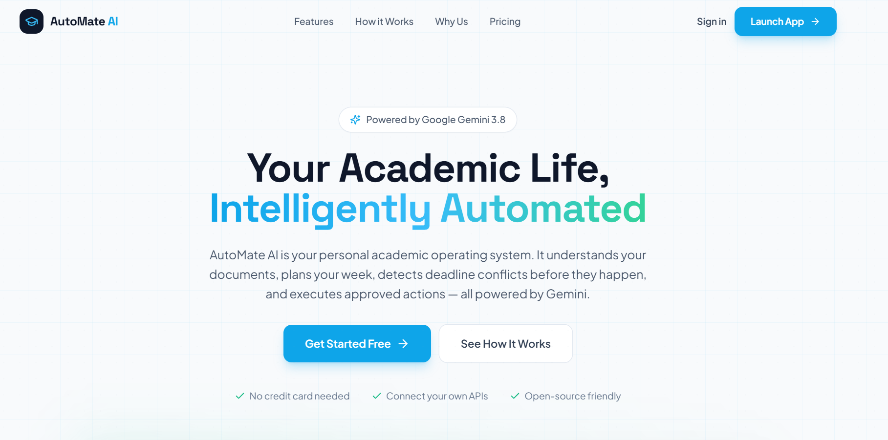
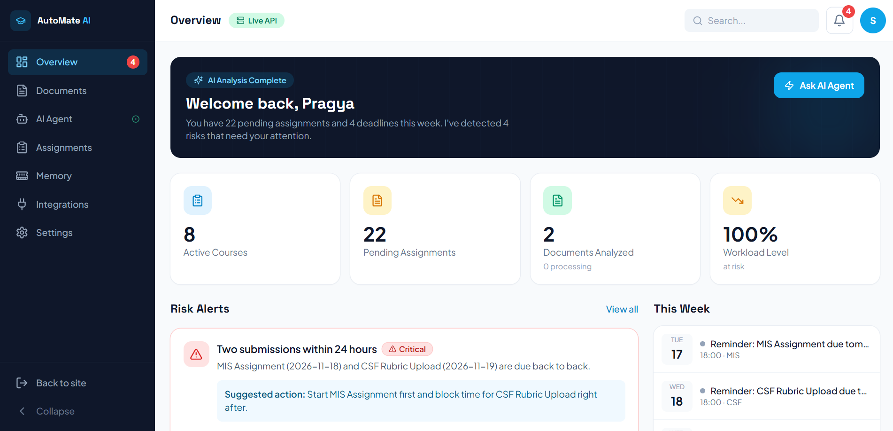
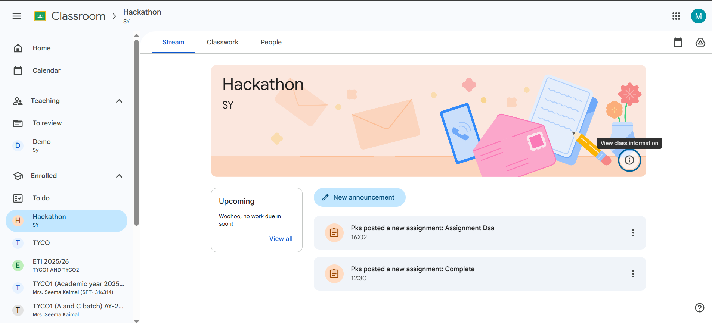
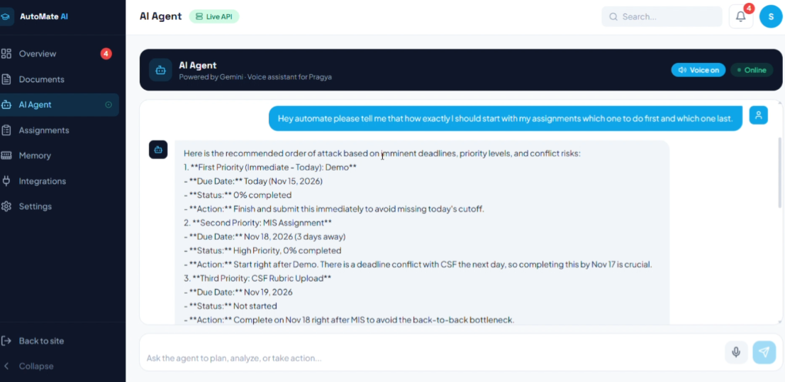
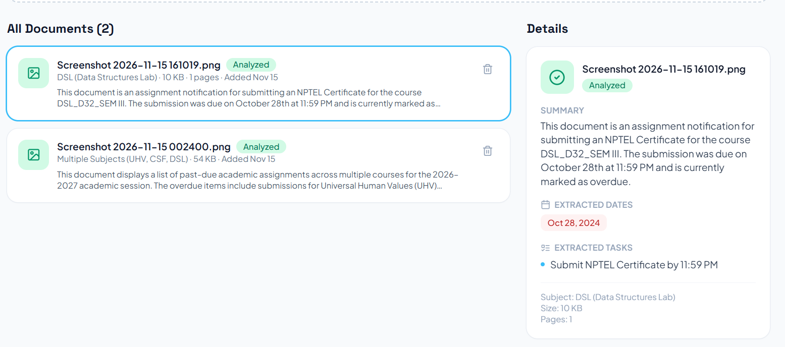
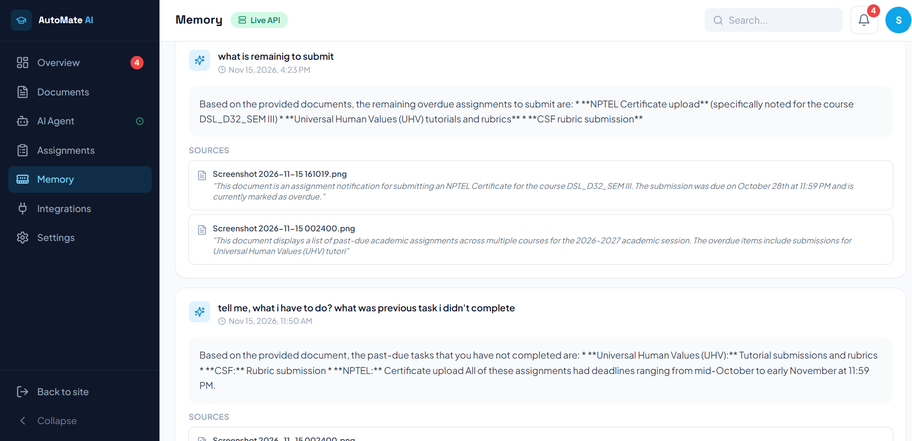

# AutoMate AI

** Your Academic Life, Intelligently Automated **

AutoMate AI brings assignments, deadlines, study documents, and planning into one student workspace. It combines a live dashboard with document analysis, academic search, Google Classroom sync, and an AI assistant that helps turn a busy workload into clear next steps.



## The problem it solves

Coursework is often spread across class platforms, announcements, PDFs, calendars, and personal notes. Students can miss a deadline or spend too much time figuring out what to do first. AutoMate AI brings that information together so students can see their workload, ask questions about their materials, and plan their next move.

## What AutoMate AI does

### Dashboard

The Overview page summarizes active courses, pending assignments, upcoming deadlines, documents analyzed, workload, and detected risks. It also highlights upcoming events and assignments that need attention.



### Assignments and Google Classroom

AutoMate AI connects to Google Classroom through Google sign-in and syncs coursework into the Assignments page. The list shows each assignment's course, due date, progress, and status. While the backend is running, it checks Classroom for new and changed coursework periodically. For an eligible assignment, **Mark done** can submit the signed-in student's work to Classroom and update its status in AutoMate AI.



### Document analysis

Upload a PDF, image, or text document to have Gemini analyze it. AutoMate AI extracts a summary, subject, dates, and actionable tasks, then saves the results to the connected database. This makes course material easier to review and gives Academic Memory content to search.



### Academic Memory

Ask questions about uploaded documents in natural language. Memory uses document embeddings and PostgreSQL with pgvector to retrieve relevant material, then asks Gemini to form an answer grounded in that material. Answers include document sources, and query history is saved so it remains available later.



### AI Agent

The Agent uses the student's assignment and document context to answer questions and help plan around deadlines. It can propose actions such as creating a task or calendar event. The student reviews and approves proposed actions before the backend executes them.


### Google Calendar

Google authorization also supports calendar event creation for approved Agent actions. Configure Google OAuth credentials in the backend and connect the account used for the calendar.

## How the workflow fits together

1. Connect Google Classroom so coursework and due dates appear in Assignments.
2. Upload course PDFs, notes, or images in Documents.
3. Review extracted dates and tasks, then ask Memory questions grounded in those materials.
4. Ask the Agent to help prioritize the current workload.
5. Review any proposed action and approve it before it is carried out.

## Technology

- **Frontend:** React, TypeScript, Vite, and Tailwind CSS
- **Backend:** Python and FastAPI
- **Database:** PostgreSQL and pgvector
- **AI:** Google Gemini for document analysis, embeddings, and Agent responses
- **Integrations:** Google OAuth, Google Classroom, and Google Calendar

## Run locally

### Configure the backend

Create `backend/.env` using `backend/.env.example` as a template. Set your own `GEMINI_API_KEY`, `DATABASE_URL`, Google OAuth credentials (for Google services), and local frontend/backend URLs. Keep `.env` private; never commit API keys, OAuth secrets, or database passwords.

Create the PostgreSQL database and apply `backend/schema.sql` once. The database needs the pgvector extension enabled.

### Start the backend

From the `backend` folder, install dependencies and start FastAPI:

```powershell
python -m pip install -r requirements.txt
python -m uvicorn main:app --reload --host 0.0.0.0 --port 8000
```

The API health check is at <http://localhost:8000/api/health> and the interactive API page is at <http://localhost:8000/docs>.

### Start the frontend

In a second terminal, from the project root:

```powershell
npm install
npm run dev
```

Open the local URL printed by Vite (normally <http://localhost:5173>). In **Settings → Backend Connection**, set the API Base URL to `http://localhost:8000` and test the connection.

### Connect Google Classroom

Enable the Google Classroom API in Google Cloud Console, configure your OAuth redirect URI as `http://localhost:8000/auth/google/callback`, and set the client ID and secret in `backend/.env`. With the backend running, open <http://localhost:8000/auth/google/login> and grant the requested access using the student account that owns the coursework. Classroom sync runs periodically while the backend is running; the API page can also trigger a manual sync when needed.

## Project structure

```text
backend/
  main.py             FastAPI routes, Gemini operations, and Google integrations
  schema.sql          PostgreSQL schema and pgvector setup
  requirements.txt    Python dependencies
  .env.example        Environment variable template
src/
  api.ts              Frontend API client and fallback data
  hooks.ts            Backend data loading and connection state
  components/
    pages/             Overview, Documents, Agent, Assignments, Memory, Settings
```


## Security

- Keep `backend/.env` out of version control and use placeholders in `.env.example`.
- The backend is configured for local development. Before hosting it publicly, use HTTPS, restrict CORS to your frontend domain, and store secrets in a secure environment configuration.
